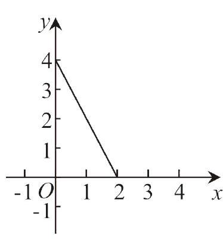
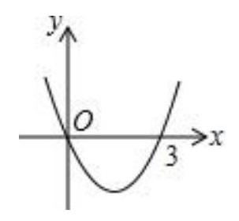

# AVP1256 — Single visual target

MV-MATH:1999_1 / MV-MATH:969_1 · same type · Numeric representation and conversion

## Shared or similar visual information

The numerical notation 3.

## Evidence locations

- Left image: The notation 3 appears at the x-axis tick to the right of the segment endpoint.
- Right image: The notation 3 appears below the right x-intercept.

## Mathematical meanings

Left image: 3 gives the horizontal-axis coordinate of that tick. Right image: 3 is the horizontal coordinate of the right zero.

## Same mathematical meanings

yes

## Rationales

The numeral gives the same horizontal coordinate in both images.

Only the selected target is annotated. AI visual-review draft; not independently double-annotated by humans.
