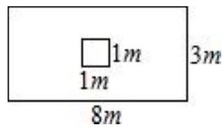
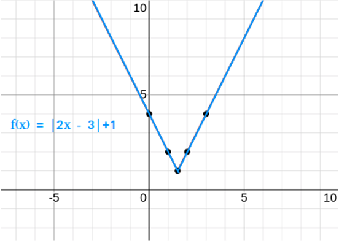

# AVP1257 — Single visual target

MV-MATH:406_2 / MathVista:23 · different type · Numeric representation and conversion

## Shared or similar visual information

The numerical notations 3 m (left) and 3 (right).

## Evidence locations

- Left image: The notation 3 m appears beside the outer rectangle's right edge.
- Right image: The notation 3 appears inside the absolute value bars in 2x − 3.

## Mathematical meanings

Left image: 3 m is the height of the outer rectangle. Right image: 3 is the magnitude of the constant subtracted from 2x.

## Same mathematical meanings

no

## Rationales

The notation on the left represents a segment length. The notation on the right represents a constant term.

Only the selected target is annotated. AI visual-review draft; not independently double-annotated by humans.
