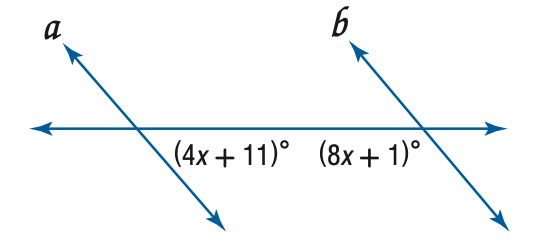
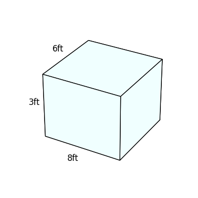

# AVP1260 — Single visual target

MathVista:855 / DynaMath:36 · different type · Numeric representation and conversion

## Shared or similar visual information

The numerical notations 8 (left) and 8 ft (right).

## Evidence locations

- Left image: The notation 8 appears in the angle expression (8x + 1)°.
- Right image: The notation 8 ft appears beside the bottom front edge.

## Mathematical meanings

Left image: 8 multiplies x in the algebraic expression for the marked angle. Right image: 8 ft gives the front width of the rectangular prism.

## Same mathematical meanings

no

## Rationales

The notation on the left represents a variable coefficient. The notation on the right represents a segment length.

Only the selected target is annotated. AI visual-review draft; not independently double-annotated by humans.
