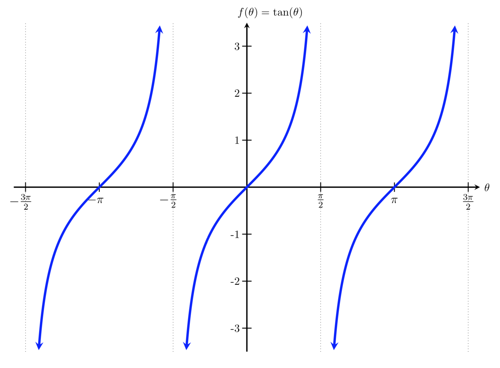
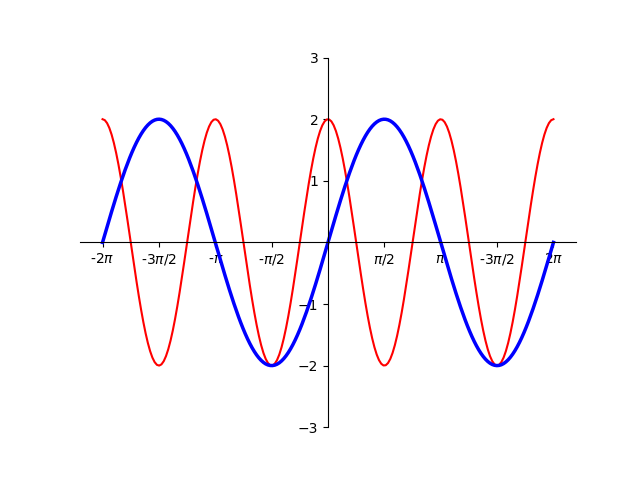

# AVP1261 — Single visual target

MathVista:661 / DynaMath:14 · same type · Numeric representation and conversion

## Shared or similar visual information

The numerical notation −π/2.

## Evidence locations

- Left image: The notation −π/2 appears below the first vertical asymptote to the left of the origin.
- Right image: The notation −π/2 appears the first labeled tick to the left of the origin.

## Mathematical meanings

Left image: −π/2 gives the input coordinate of that asymptote. Right image: −π/2 is the horizontal input coordinate at that tick.

## Same mathematical meanings

yes

## Rationales

The numeral gives the same horizontal coordinate in both images.

Only the selected target is annotated. AI visual-review draft; not independently double-annotated by humans.
