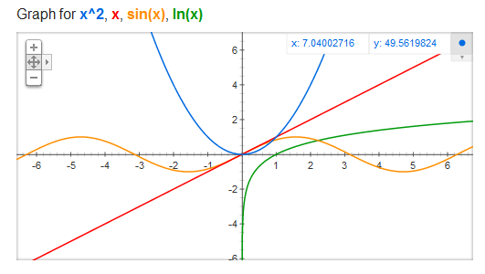
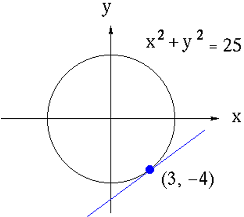

# AVP1262 — Single visual target

MathVista:302 / MathVista:767 · different type · Numeric representation and conversion

## Shared or similar visual information

The exponent 2 in the expressions x^2 and x².

## Evidence locations

- Left image: The notation x^2 appears in the graph title naming the blue trace.
- Right image: The notation x² appears in the first term of the circle equation.

## Mathematical meanings

Left image: The variable x is squared in the expression listed for the blue trace. Right image: The variable x is squared in the equation defining the circle.

## Same mathematical meanings

yes

## Rationales

The exponent 2 applies squaring to the base shown in each formula.

Only the selected target is annotated. AI visual-review draft; not independently double-annotated by humans.
