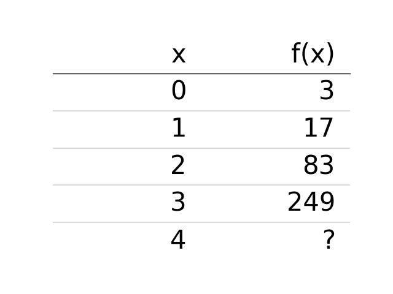
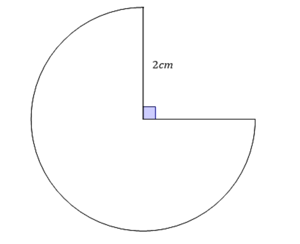

# AVP1263 — Single visual target

DynaMath:108 / MathVerse:394 · different type · Numeric representation and conversion

## Shared or similar visual information

The numerical notations 2 (left) and 2 cm (right).

## Evidence locations

- Left image: The notation 2 appears the third data row of the x column.
- Right image: The notation 2 cm appears beside the vertical radius.

## Mathematical meanings

Left image: 2 is the input at which the table gives f(x) = 83. Right image: 2 cm is the radius of the circular outline.

## Same mathematical meanings

no

## Rationales

The notation on the left represents a tabulated input value. The notation on the right represents a radius length in centimeters.

Only the selected target is annotated. AI visual-review draft; not independently double-annotated by humans.
