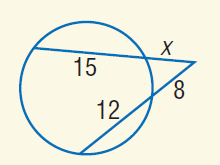
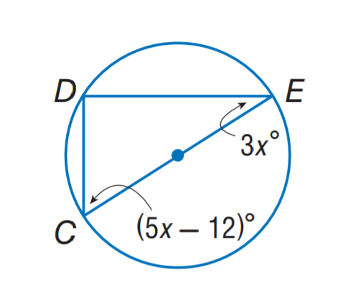

# AVP1265 — Single visual target

MathVista:757 / MathVista:951 · same type · Numeric representation and conversion

## Shared or similar visual information

The numerical notation 12.

## Evidence locations

- Left image: The notation 12 appears beside the interior portion of the lower secant.
- Right image: The notation 12 appears in the angle expression (5x − 12)° beside C.

## Mathematical meanings

Left image: 12 gives the length of the interior secant segment. Right image: 12 is subtracted in the expression for the angle at C.

## Same mathematical meanings

no

## Rationales

The notation on the left represents a segment length. The notation on the right represents a constant term.

Only the selected target is annotated. AI visual-review draft; not independently double-annotated by humans.
