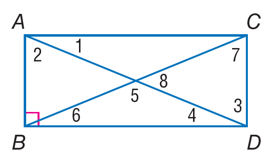
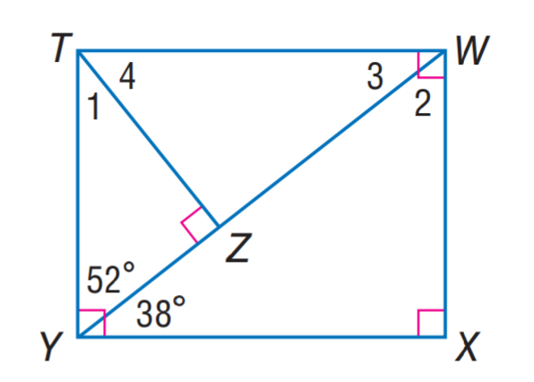

# AVP1266 — Single visual target

MathVista:499 / MathVista:48 · same type · Numeric representation and conversion

## Shared or similar visual information

The bare numeral 4.

## Evidence locations

- Left image: The notation 4 appears near D between DB and DA.
- Right image: The notation 4 appears between the top side and TZ.

## Mathematical meanings

Left image: 4 names the angle between the bottom edge and diagonal at D. Right image: 4 names the marked part of the angle at T.

## Same mathematical meanings

yes

## Rationales

The bare numeral 4 is associated with an angle in both drawings and identifies which angle is referenced.

Only the selected target is annotated. AI visual-review draft; not independently double-annotated by humans.
