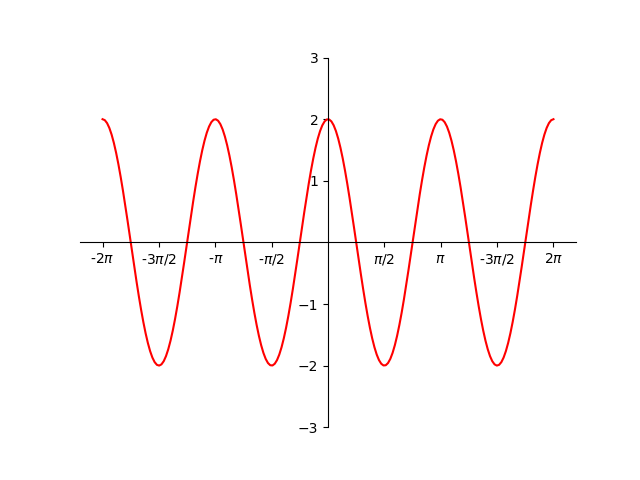
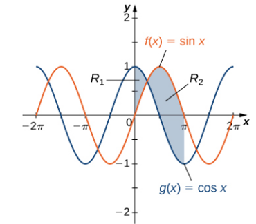

# AVP1269 — Single visual target

DynaMath:12 / MathVista:287 · same type · Numeric representation and conversion

## Shared or similar visual information

The numerical notation π.

## Evidence locations

- Left image: The notation π appears the x-axis tick just right of π/2.
- Right image: The notation π appears on the positive horizontal axis below the right region.

## Mathematical meanings

Left image: π is the horizontal input coordinate at that tick. Right image: π gives the horizontal coordinate at that tick.

## Same mathematical meanings

yes

## Rationales

The numeral gives the same horizontal coordinate in both images.

Only the selected target is annotated. AI visual-review draft; not independently double-annotated by humans.
