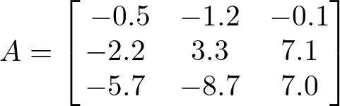
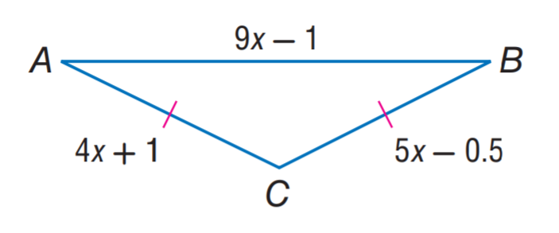

# AVP1270 — Single visual target

DynaMath:474 / MathVista:375 · different type · Numeric representation and conversion

## Shared or similar visual information

The numerical notation −0.5.

## Evidence locations

- Left image: The notation −0.5 appears first row and first column of matrix A.
- Right image: The notation −0.5 appears in 5x − 0.5 on the right side of the triangle.

## Mathematical meanings

Left image: −0.5 is the top-left entry of A. Right image: 0.5 is subtracted in the length expression for BC.

## Same mathematical meanings

no

## Rationales

The notation on the left represents a matrix entry. The notation on the right represents a constant term.

Only the selected target is annotated. AI visual-review draft; not independently double-annotated by humans.
