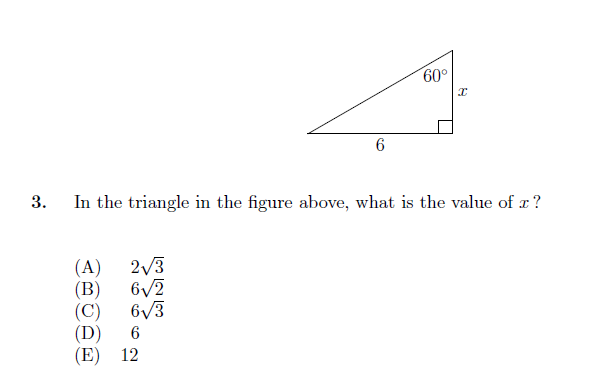
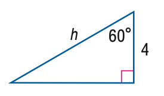

# AVP1273 — Single visual target

MathVista:698 / MathVista:665 · same type · Numeric representation and conversion

## Shared or similar visual information

The numerical notation 60°.

## Evidence locations

- Left image: The notation 60° appears at the upper-right vertex of the printed triangle.
- Right image: The notation 60° appears beside the upper-right acute angle.

## Mathematical meanings

Left image: 60° measures the angle at the top of the vertical leg x. Right image: 60° measures the angle between the vertical leg and the hypotenuse.

## Same mathematical meanings

yes

## Rationales

Each notation is placed next to the marked angle and specifies the same angle measure of 60°.

Only the selected target is annotated. AI visual-review draft; not independently double-annotated by humans.
