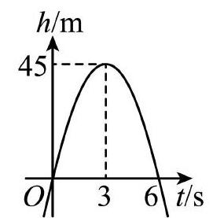
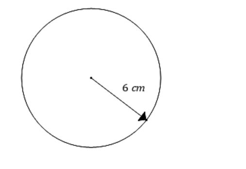

# AVP1278 — Single visual target

MV-MATH:624_1 / MathVerse:393 · different type · Numeric representation and conversion

## Shared or similar visual information

The numerical notations 6 (left) and 6 cm (right).

## Evidence locations

- Left image: The notation 6 appears below the right intercept.
- Right image: The notation 6 cm appears near the radial arrow.

## Mathematical meanings

Left image: 6 s is the time at which the height returns to zero. Right image: 6 cm is the circle radius.

## Same mathematical meanings

no

## Rationales

The notation on the left represents a time coordinate. The notation on the right represents a radius length in centimeters.

Only the selected target is annotated. AI visual-review draft; not independently double-annotated by humans.
