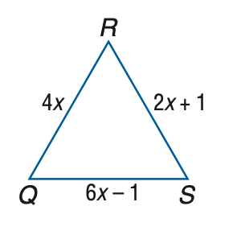
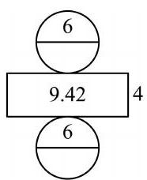

# AVP1280 — Single visual target

MathVista:176 / MV-MATH:552_1 · different type · Numeric representation and conversion

## Shared or similar visual information

The numerical notation 4.

## Evidence locations

- Left image: The notation 4 appears in 4x next to RQ.
- Right image: The notation 4 appears to the right of the rectangle in the cylinder net.

## Mathematical meanings

Left image: 4 multiplies x to give the length of RQ. Right image: 4 gives the height of the lateral rectangle.

## Same mathematical meanings

no

## Rationales

The notation on the left represents a variable coefficient. The notation on the right represents a segment length.

Only the selected target is annotated. AI visual-review draft; not independently double-annotated by humans.
