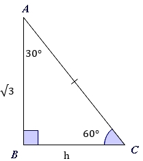
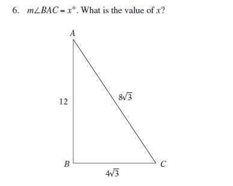

# AVP1284 — Single visual target

MathVerse:369 / MathVista:920 · same type · Numeric representation and conversion

## Shared or similar visual information

The numerical notations √3 (left) and 4√3 (right).

## Evidence locations

- Left image: The notation √3 appears left of AB.
- Right image: The notation 4√3 appears below BC.

## Mathematical meanings

Left image: √3 gives the vertical leg length AB. Right image: 4√3 gives the lower side length BC.

## Same mathematical meanings

no

## Rationales

The left notation √3 and the right notation 4√3 represent lengths expressed using √3. Their different multipliers give different lengths.

Only the selected target is annotated. AI visual-review draft; not independently double-annotated by humans.
