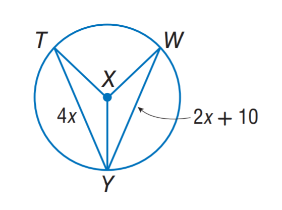
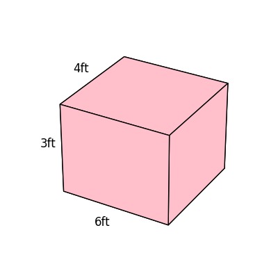

# AVP1285 — Single visual target

MathVista:283 / DynaMath:74 · different type · Numeric representation and conversion

## Shared or similar visual information

The numerical notations 4 (left) and 4 ft (right).

## Evidence locations

- Left image: The notation 4 appears in 4x by chord TY.
- Right image: The notation 4 ft appears beside the upper-left slanted edge of the prism.

## Mathematical meanings

Left image: 4 multiplies x to give chord length TY. Right image: 4 ft gives the prism depth.

## Same mathematical meanings

no

## Rationales

The notation on the left represents a variable coefficient. The notation on the right represents a segment length.

Only the selected target is annotated. AI visual-review draft; not independently double-annotated by humans.
