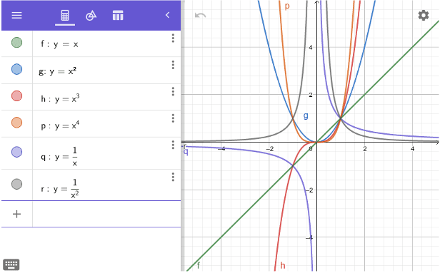

# AVP1286 — Single visual target

MathVista:991 / MathVista:369 · same type · Numeric representation and conversion

## Shared or similar visual information

The exponent 3 in x³.

## Evidence locations

- Left image: The notation x³ appears in the formula h: y = x³ in the color legend.
- Right image: The notation x³ appears in the blue formula f(x) = x³.

## Mathematical meanings

Left image: The variable x is cubed in the rule for the trace h. Right image: The variable x is cubed in the displayed function rule.

## Same mathematical meanings

yes

## Rationales

The exponent 3 applies cubing to the base shown in each formula.

Only the selected target is annotated. AI visual-review draft; not independently double-annotated by humans.
