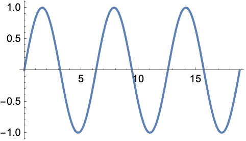
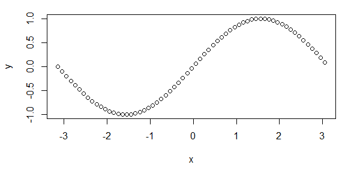

# AVP1287 — Single visual target

MathVista:308 / MathVista:118 · same type · Numeric representation and conversion

## Shared or similar visual information

The numerical notation 0.5.

## Evidence locations

- Left image: The notation 0.5 appears at the vertical-axis tick midway above the x-axis.
- Right image: The notation 0.5 appears at the vertical-axis tick midway between 0.0 and 1.0.

## Mathematical meanings

Left image: 0.5 is a vertical-axis coordinate. Right image: 0.5 is the vertical coordinate at that tick.

## Same mathematical meanings

yes

## Rationales

The numeral gives the same vertical coordinate in both images.

Only the selected target is annotated. AI visual-review draft; not independently double-annotated by humans.
