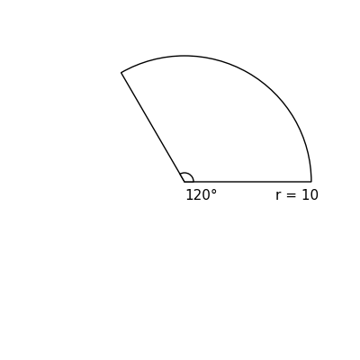
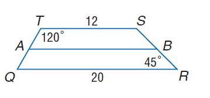

# AVP1288 — Single visual target

DynaMath:123 / MathVista:866 · same type · Numeric representation and conversion

## Shared or similar visual information

The numerical notation 120°.

## Evidence locations

- Left image: The notation 120° appears beside the arc at the sector vertex.
- Right image: The notation 120° appears inside the upper-left vertex T.

## Mathematical meanings

Left image: 120° gives the angle between the sector radii. Right image: 120° measures the marked interior angle at T.

## Same mathematical meanings

yes

## Rationales

Each notation is placed next to the marked angle and specifies the same angle measure of 120°.

Only the selected target is annotated. AI visual-review draft; not independently double-annotated by humans.
