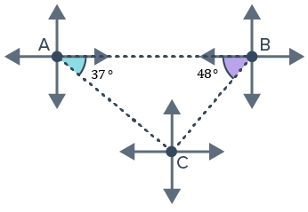
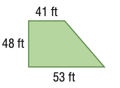

# AVP1291 — Single visual target

MathVerse:337 / MathVista:318 · same type · Numeric representation and conversion

## Shared or similar visual information

The numerical notations 48° (left) and 48 ft (right).

## Evidence locations

- Left image: The notation 48° appears next to the purple wedge at B.
- Right image: The notation 48 ft appears beside the left vertical side.

## Mathematical meanings

Left image: 48° measures the bearing offset between the westward horizontal ray and BC. Right image: 48 ft gives the height between the parallel bases.

## Same mathematical meanings

no

## Rationales

The notation on the left represents an angle measure. The notation on the right represents a height.

Only the selected target is annotated. AI visual-review draft; not independently double-annotated by humans.
