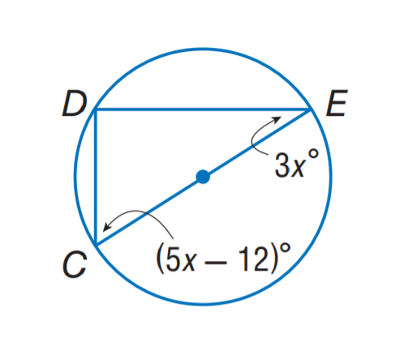
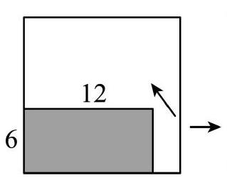

# AVP1293 — Single visual target

MathVista:951 / MV-MATH:934_1 · same type · Numeric representation and conversion

## Shared or similar visual information

The numerical notation 12.

## Evidence locations

- Left image: The notation 12 appears in the angle expression (5x − 12)° beside C.
- Right image: The notation 12 appears above the gray inner rectangle.

## Mathematical meanings

Left image: 12 is subtracted in the expression for the angle at C. Right image: 12 labels the horizontal side of the gray rectangle.

## Same mathematical meanings

no

## Rationales

The notation on the left represents a constant term. The notation on the right represents a segment length.

Only the selected target is annotated. AI visual-review draft; not independently double-annotated by humans.
