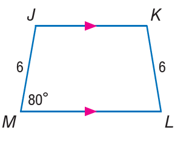
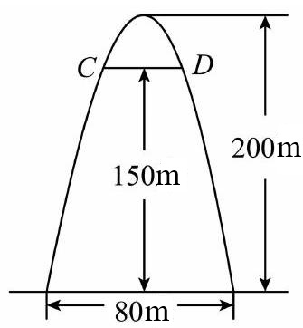

# AVP1295 — Single visual target

MathVista:786 / MV-MATH:628_2 · same type · Numeric representation and conversion

## Shared or similar visual information

The numerical notations 80° (left) and 80 m (right).

## Evidence locations

- Left image: The notation 80° appears beside the lower-left vertex M.
- Right image: The notation 80 m appears beneath the horizontal dimension arrow.

## Mathematical meanings

Left image: 80° measures the angle between MJ and ML. Right image: 80 m gives the span between the parabola's two base points.

## Same mathematical meanings

no

## Rationales

The notation on the left represents an angle measure. The notation on the right represents a segment length.

Only the selected target is annotated. AI visual-review draft; not independently double-annotated by humans.
