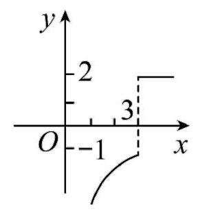
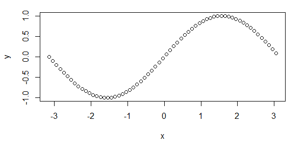

# AVP1298 — Single visual target

MV-MATH:94_1 / MathVista:118 · same type · Numeric representation and conversion

## Shared or similar visual information

The numerical notations −1 (left) and −1.0 (right).

## Evidence locations

- Left image: The notation −1 appears at the marked tick below the horizontal axis.
- Right image: The notation −1.0 appears at the bottom label on the vertical axis.

## Mathematical meanings

Left image: −1 is a vertical coordinate below the origin. Right image: −1.0 is the marked vertical coordinate at the bottom of the scale.

## Same mathematical meanings

yes

## Rationales

−1 and −1.0 denote equal values, and both give a vertical coordinate.

Only the selected target is annotated. AI visual-review draft; not independently double-annotated by humans.
