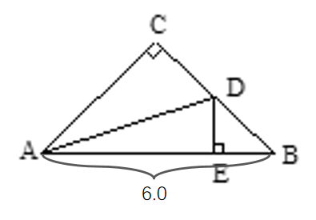
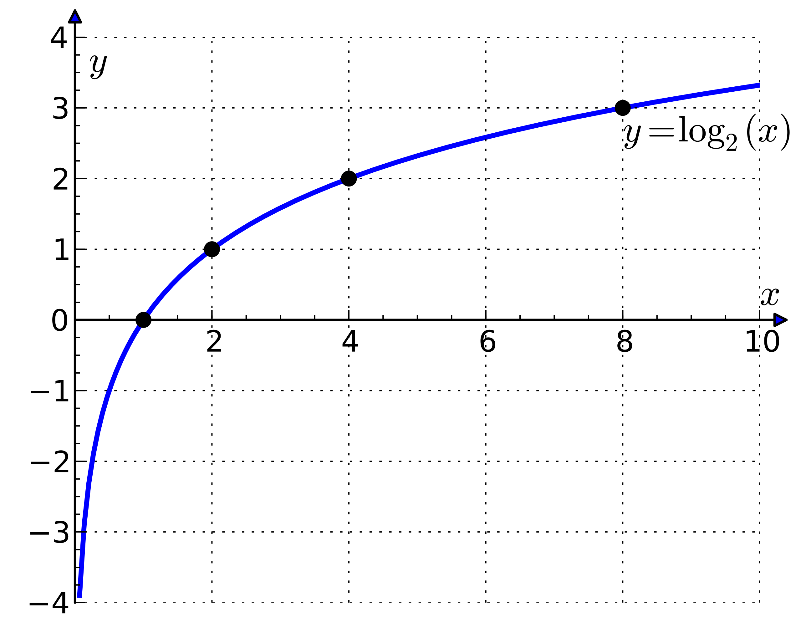

# AVP1299 — Single visual target

MathVerse:9 / MathVista:329 · different type · Numeric representation and conversion

## Shared or similar visual information

The numerical notations 6.0 (left) and 6 (right).

## Evidence locations

- Left image: The notation 6.0 appears under the brace spanning AB.
- Right image: The notation 6 appears below the horizontal axis between labels 4 and 8.

## Mathematical meanings

Left image: 6.0 gives the length of AB opposite the right angle at C. Right image: 6 gives the horizontal-axis input at that tick.

## Same mathematical meanings

no

## Rationales

The notation on the left represents a hypotenuse length. The notation on the right represents a horizontal coordinate.

Only the selected target is annotated. AI visual-review draft; not independently double-annotated by humans.
