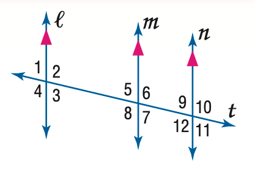
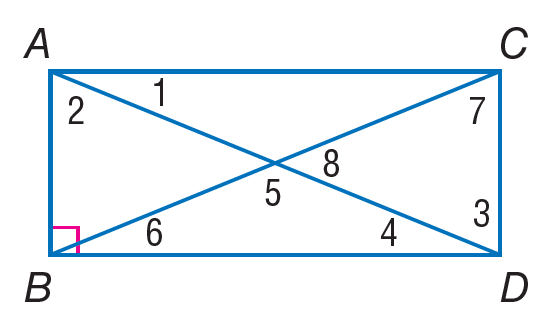

# AVP1300 — Single visual target

MathVista:938 / MathVista:499 · same type · Numeric representation and conversion

## Shared or similar visual information

The bare numeral 8.

## Evidence locations

- Left image: The notation 8 appears lower-left wedge at the middle crossing.
- Right image: The notation 8 appears to the right of the diagonal crossing.

## Mathematical meanings

Left image: 8 names the indicated angle at that crossing. Right image: 8 names the right-hand angle formed by the diagonals.

## Same mathematical meanings

yes

## Rationales

The bare numeral 8 is associated with an angle in both drawings and identifies which angle is referenced.

Only the selected target is annotated. AI visual-review draft; not independently double-annotated by humans.
