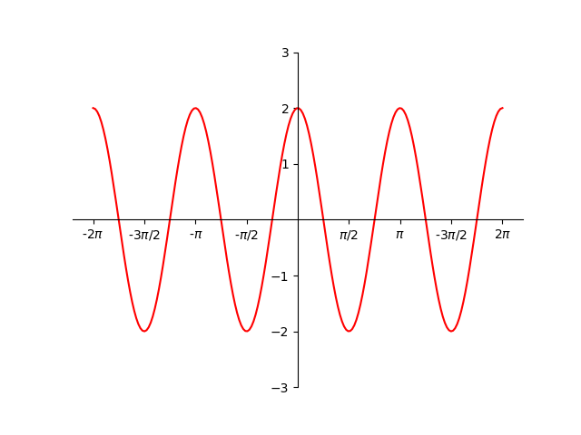
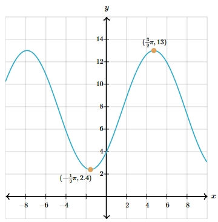

# AVP1305 — Single visual target

DynaMath:12 / MathVerse:532 · same type · Numeric representation and conversion

## Shared or similar visual information

The numerical notations −π/2 (left) and −(1/2)π (right).

## Evidence locations

- Left image: The notation −π/2 appears the first labeled tick to the left of the origin.
- Right image: The notation −(1/2)π appears inside the label by the lower orange point.

## Mathematical meanings

Left image: −π/2 is the horizontal input coordinate at that tick. Right image: −π/2 is the horizontal coordinate of the marked trough.

## Same mathematical meanings

yes

## Rationales

−π/2 and −(1/2)π denote equal values, and both give a horizontal coordinate.

Only the selected target is annotated. AI visual-review draft; not independently double-annotated by humans.
