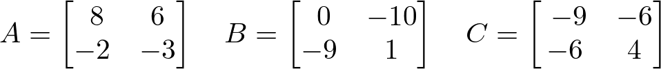
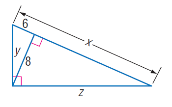

# AVP1306 — Single visual target

DynaMath:487 / MathVista:310 · different type · Numeric representation and conversion

## Shared or similar visual information

The numerical notation 8.

## Evidence locations

- Left image: The notation 8 appears top-left cell of matrix A.
- Right image: The notation 8 appears next to the interior segment with the pink square at the upper end.

## Mathematical meanings

Left image: 8 is the top-left entry of A. Right image: 8 is the altitude to the hypotenuse.

## Same mathematical meanings

no

## Rationales

The notation on the left represents a matrix entry. The notation on the right represents a height.

Only the selected target is annotated. AI visual-review draft; not independently double-annotated by humans.
