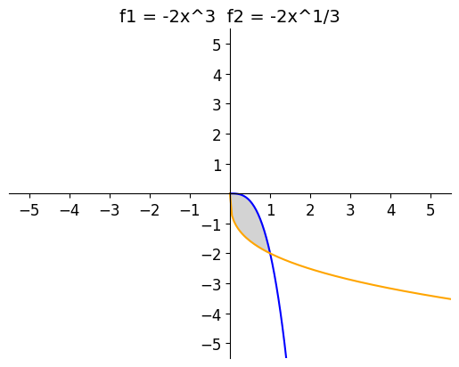

# AVP1307 — Single visual target

MathVista:369 / DynaMath:119 · same type · Numeric representation and conversion

## Shared or similar visual information

The exponent 3 in the expressions x³ and x^3.

## Evidence locations

- Left image: The notation x³ appears in the blue formula f(x) = x³.
- Right image: The notation x^3 appears in the title formula for f1.

## Mathematical meanings

Left image: The variable x is cubed in the displayed function rule. Right image: The variable x is cubed in the first plotted function.

## Same mathematical meanings

yes

## Rationales

The exponent 3 applies cubing to the base shown in each formula.

Only the selected target is annotated. AI visual-review draft; not independently double-annotated by humans.
