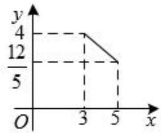

# AVP1309 — Single visual target

MV-MATH:96_1 / MathVista:767 · different type · Numeric representation and conversion

## Shared or similar visual information

The numerical notations 4 (left) and −4 (right).

## Evidence locations

- Left image: The notation 4 appears on the y-axis beside the upper horizontal guide.
- Right image: The notation −4 appears second coordinate of the blue point label (3, −4).

## Mathematical meanings

Left image: 4 is the height of the segment's left endpoint. Right image: −4 gives the vertical coordinate of the tangent point.

## Same mathematical meanings

no

## Rationales

The numeric forms have opposite signs (4 and −4), so they denote different values in the same mathematical role.

Only the selected target is annotated. AI visual-review draft; not independently double-annotated by humans.
