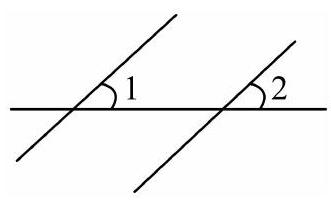
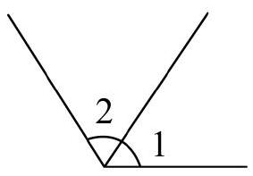

# AVP1310 — Single visual target

MV-MATH:471_1 / MV-MATH:465_1 · same type · Numeric representation and conversion

## Shared or similar visual information

The bare numeral 1.

## Evidence locations

- Left image: The notation 1 appears at the left crossing above the transversal.
- Right image: The notation 1 appears right of the middle ray above the horizontal ray.

## Mathematical meanings

Left image: 1 identifies the marked angle at the left crossing. Right image: 1 names the right-hand marked angle at the common vertex.

## Same mathematical meanings

yes

## Rationales

The bare numeral 1 is associated with an angle in both drawings and identifies which angle is referenced.

Only the selected target is annotated. AI visual-review draft; not independently double-annotated by humans.
