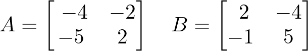
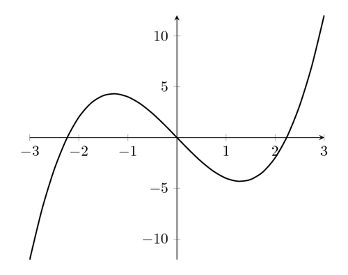

# AVP1312 — Single visual target

DynaMath:488 / MathVista:762 · different type · Numeric representation and conversion

## Shared or similar visual information

The numerical notation −2.

## Evidence locations

- Left image: The notation −2 appears top-right cell of matrix A.
- Right image: The notation −2 appears at the second labeled tick left of the origin.

## Mathematical meanings

Left image: −2 is the top-right entry of A. Right image: −2 gives the x-coordinate at that tick.

## Same mathematical meanings

no

## Rationales

The minus sign is part of the plotted coordinate. The notation on the left represents a matrix entry. The notation on the right represents a horizontal coordinate.

Only the selected target is annotated. AI visual-review draft; not independently double-annotated by humans.
