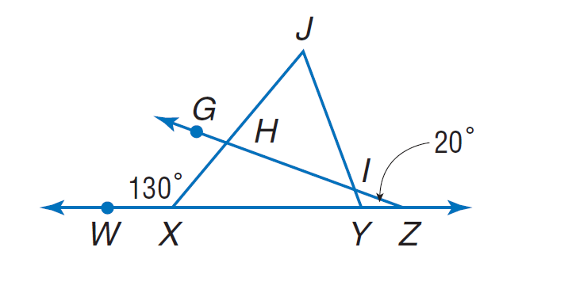
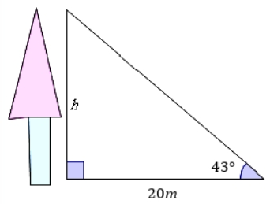

# AVP1320 — Single visual target

MathVista:360 / MathVerse:347 · same type · Numeric representation and conversion

## Shared or similar visual information

The numerical notations 20° (left) and 20 m (right).

## Evidence locations

- Left image: The notation 20° appears at the tip of the curved annotation near Z.
- Right image: The notation 20 m appears under the right triangle base.

## Mathematical meanings

Left image: 20° measures the marked angle where the long oblique line meets the baseline. Right image: 20 m is the horizontal ground distance in the tree-height construction.

## Same mathematical meanings

no

## Rationales

The notation on the left represents an angle measure. The notation on the right represents a segment length.

Only the selected target is annotated. AI visual-review draft; not independently double-annotated by humans.
