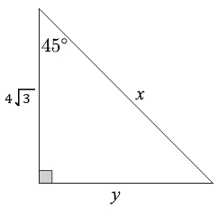
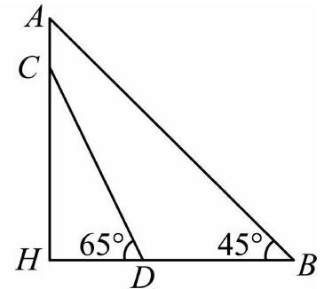

# AVP1324 — Single visual target

MathVerse:375 / MV-MATH:1854_2 · same type · Numeric representation and conversion

## Shared or similar visual information

The numerical notation 45°.

## Evidence locations

- Left image: The notation 45° appears at the upper-left corner inside the triangle.
- Right image: The notation 45° appears beside the angle arc at B.

## Mathematical meanings

Left image: 45° measures the acute angle at that corner. Right image: 45° measures the angle between BA and BH.

## Same mathematical meanings

yes

## Rationales

Each notation is placed next to the marked angle and specifies the same angle measure of 45°.

Only the selected target is annotated. AI visual-review draft; not independently double-annotated by humans.
