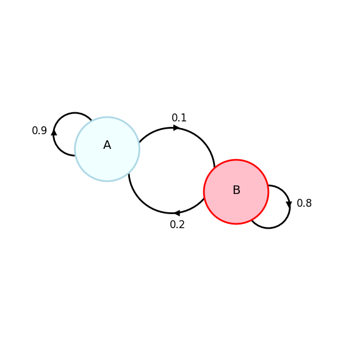
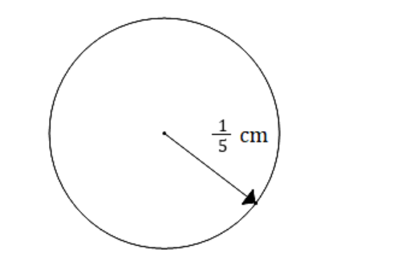

# AVP1325 — Single visual target

DynaMath:72 / MathVerse:398 · different type · Numeric representation and conversion

## Shared or similar visual information

The numerical notations 0.2 (left) and 1/5 cm (right).

## Evidence locations

- Left image: The notation 0.2 appears on the lower arrow from node B to node A.
- Right image: The notation 1/5 cm appears next to the radial arrow.

## Mathematical meanings

Left image: 0.2 is the transition probability from B to A. Right image: 1/5 cm gives the circle radius.

## Same mathematical meanings

no

## Rationales

The notation on the left represents a transition probability. The notation on the right represents a radius length in centimeters.

Only the selected target is annotated. AI visual-review draft; not independently double-annotated by humans.
