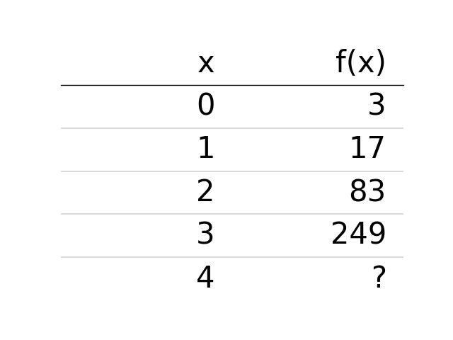
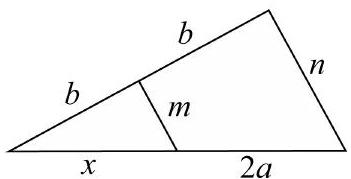

# AVP1326 — Single visual target

DynaMath:108 / MV-MATH:527_1 · different type · Numeric representation and conversion

## Shared or similar visual information

The numerical notation 2.

## Evidence locations

- Left image: The notation 2 appears the third data row of the x column.
- Right image: The notation 2 appears in 2a along the bottom side.

## Mathematical meanings

Left image: 2 is the input at which the table gives f(x) = 83. Right image: 2 multiplies a in the expression for the right base segment.

## Same mathematical meanings

no

## Rationales

The notation on the left represents a tabulated input value. The notation on the right represents a variable coefficient.

Only the selected target is annotated. AI visual-review draft; not independently double-annotated by humans.
