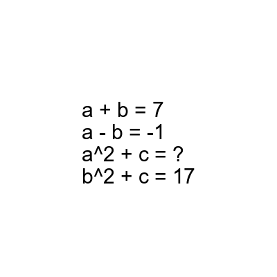

# AVP1333 — Single visual target

DynaMath:499 / DynaMath:53 · different type · Numeric representation and conversion

## Shared or similar visual information

The numerical notation 7.

## Evidence locations

- Left image: The notation 7 appears on the right of a + b = 7.
- Right image: The notation 7 appears in the annotation R = 7.

## Mathematical meanings

Left image: 7 is the value of the sum a + b. Right image: 7 gives the radius of the outer circle.

## Same mathematical meanings

no

## Rationales

The notation on the left represents a value on the right of an equation. The notation on the right represents a radius length.

Only the selected target is annotated. AI visual-review draft; not independently double-annotated by humans.
