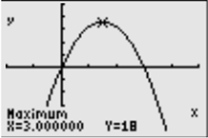
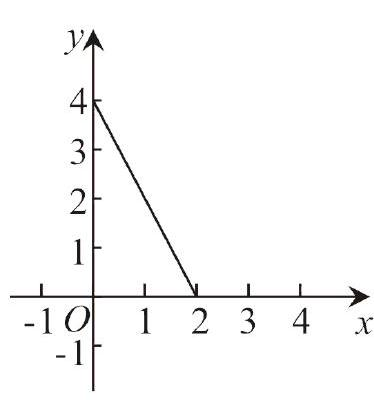

# AVP1334 — Single visual target

MathVista:217 / MV-MATH:1999_1 · same type · Numeric representation and conversion

## Shared or similar visual information

The numerical notations 3.000000 (left) and 3 (right).

## Evidence locations

- Left image: The notation 3.000000 appears in the calculator display under the word Maximum.
- Right image: The notation 3 appears at the x-axis tick to the right of the segment endpoint.

## Mathematical meanings

Left image: 3.000000 gives the x-coordinate where the calculator finds a maximum. Right image: 3 gives the horizontal-axis coordinate of that tick.

## Same mathematical meanings

yes

## Rationales

3.000000 and 3 denote equal values, and both give a horizontal coordinate.

Only the selected target is annotated. AI visual-review draft; not independently double-annotated by humans.
