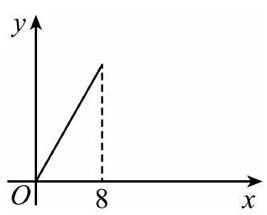
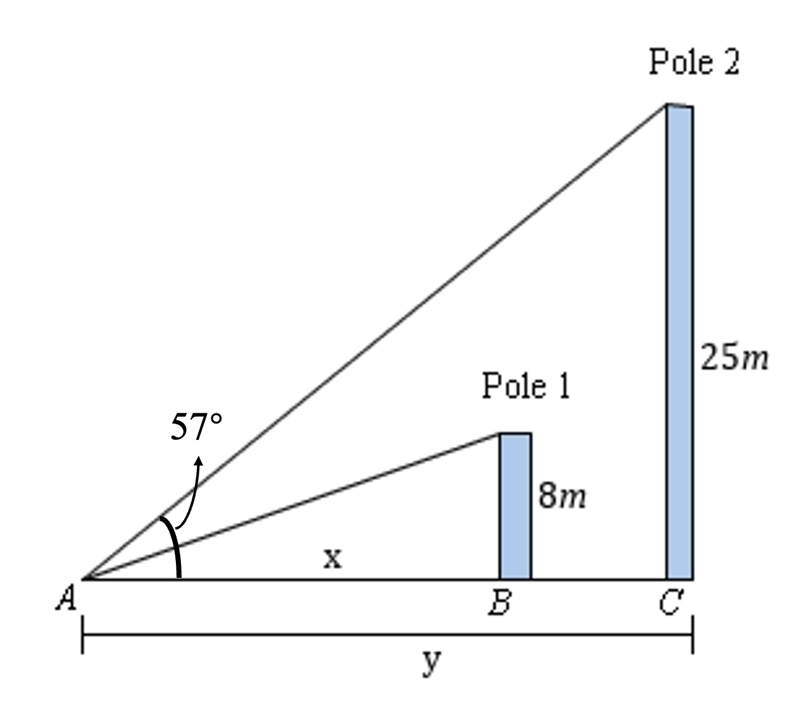

# AVP1335 — Single visual target

MV-MATH:103_1 / MathVerse:351 · different type · Numeric representation and conversion

## Shared or similar visual information

The numerical notations 8 (left) and 8 m (right).

## Evidence locations

- Left image: The notation 8 appears beneath the vertical dashed projection.
- Right image: The notation 8 m appears beside the nearer pole at B.

## Mathematical meanings

Left image: 8 is the horizontal coordinate of the line segment's upper endpoint. Right image: 8 m gives the height of Pole 1.

## Same mathematical meanings

no

## Rationales

The notation on the left represents a horizontal coordinate. The notation on the right represents a height.

Only the selected target is annotated. AI visual-review draft; not independently double-annotated by humans.
