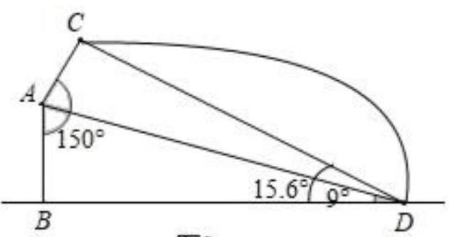
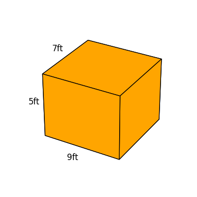

# AVP1336 — Single visual target

MV-MATH:1889_2 / DynaMath:60 · different type · Numeric representation and conversion

## Shared or similar visual information

The numerical notations 9° (left) and 9 ft (right).

## Evidence locations

- Left image: The notation 9° appears beside the small arc at D next to the baseline.
- Right image: The notation 9 ft appears beside the front bottom edge.

## Mathematical meanings

Left image: 9° measures the lower marked angle at D. Right image: 9 ft gives the front width of the rectangular prism.

## Same mathematical meanings

no

## Rationales

The notation on the left represents an angle measure. The notation on the right represents a segment length.

Only the selected target is annotated. AI visual-review draft; not independently double-annotated by humans.
