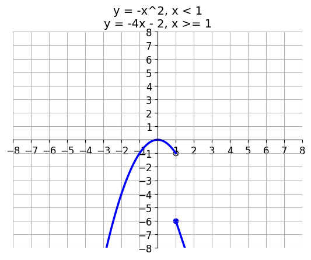
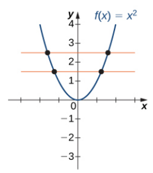

# AVP1337 — Single visual target

DynaMath:86 / MathVista:137 · same type · Numeric representation and conversion

## Shared or similar visual information

The exponent 2 in the expressions x^2 and x².

## Evidence locations

- Left image: The notation x^2 appears in the formula for the branch with x < 1.
- Right image: The notation x² appears in the blue expression f(x) = x².

## Mathematical meanings

Left image: The variable x is raised to the second power in the first branch formula. Right image: The variable x is squared in the displayed function rule.

## Same mathematical meanings

yes

## Rationales

The exponent 2 applies squaring to the base shown in each formula.

Only the selected target is annotated. AI visual-review draft; not independently double-annotated by humans.
