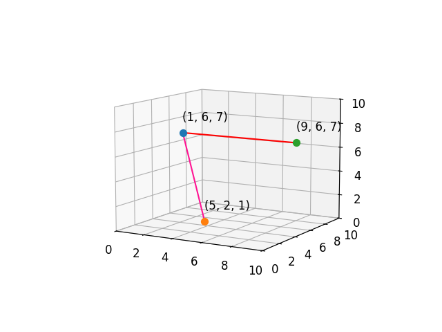
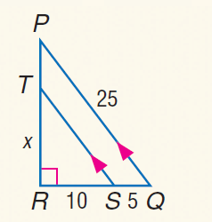

# AVP1338 — Single visual target

DynaMath:320 / MathVista:238 · different type · Numeric representation and conversion

## Shared or similar visual information

The numerical notation 5.

## Evidence locations

- Left image: The notation 5 appears first entry of the orange point label (5, 2, 1).
- Right image: The notation 5 appears below SQ.

## Mathematical meanings

Left image: 5 gives the first coordinate of the orange point. Right image: 5 gives the lower segment length SQ.

## Same mathematical meanings

no

## Rationales

The notation on the left represents a horizontal coordinate. The notation on the right represents a segment length.

Only the selected target is annotated. AI visual-review draft; not independently double-annotated by humans.
