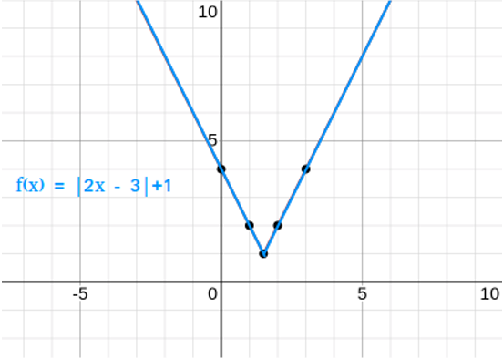
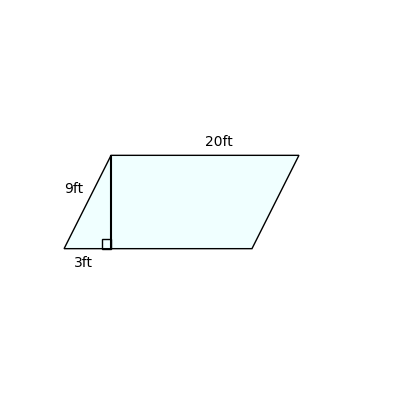

# AVP1341 — Single visual target

MathVista:23 / DynaMath:34 · different type · Numeric representation and conversion

## Shared or similar visual information

The numerical notations 3 (left) and 3 ft (right).

## Evidence locations

- Left image: The notation 3 appears inside the absolute value bars in 2x − 3.
- Right image: The notation 3 ft appears under the short extension to the left of the altitude.

## Mathematical meanings

Left image: 3 is the magnitude of the constant subtracted from 2x. Right image: 3 ft measures the horizontal distance from the left tip to the foot of the altitude.

## Same mathematical meanings

no

## Rationales

The notation on the left represents a constant term. The notation on the right represents a segment length.

Only the selected target is annotated. AI visual-review draft; not independently double-annotated by humans.
