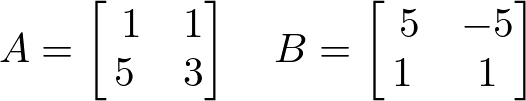
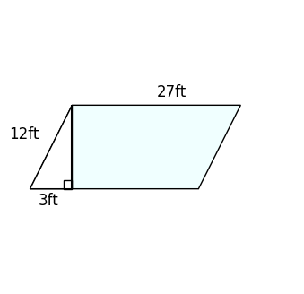

# AVP1342 — Single visual target

DynaMath:485 / DynaMath:189 · different type · Numeric representation and conversion

## Shared or similar visual information

The numerical notations 3 (left) and 3 ft (right).

## Evidence locations

- Left image: The notation 3 appears bottom-right cell of matrix A.
- Right image: The notation 3 ft appears below the short horizontal extension.

## Mathematical meanings

Left image: 3 is the bottom-right entry of A. Right image: 3 ft gives the offset from the left vertex to the foot of the altitude.

## Same mathematical meanings

no

## Rationales

The notation on the left represents a matrix entry. The notation on the right represents a segment length.

Only the selected target is annotated. AI visual-review draft; not independently double-annotated by humans.
