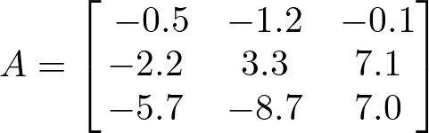
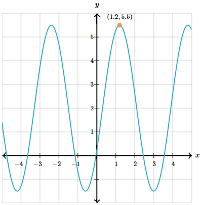

# AVP1346 — Single visual target

DynaMath:474 / MathVerse:531 · different type · Numeric representation and conversion

## Shared or similar visual information

The numerical notations −1.2 (left) and 1.2 (right).

## Evidence locations

- Left image: The notation −1.2 appears first row and second column of matrix A.
- Right image: The notation 1.2 appears first component of the marked coordinate pair (1.2, 5.5).

## Mathematical meanings

Left image: −1.2 is an entry of A. Right image: 1.2 is the horizontal coordinate of the marked peak.

## Same mathematical meanings

no

## Rationales

The notation on the left represents a matrix entry. The notation on the right represents a horizontal coordinate.

Only the selected target is annotated. AI visual-review draft; not independently double-annotated by humans.
