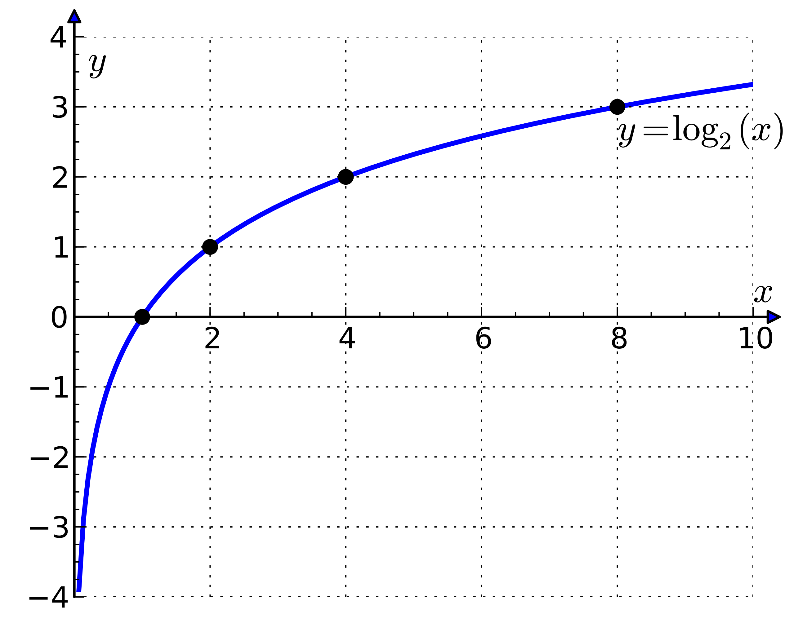

# AVP1347 — Single visual target

MathVista:329 / MathVista:671 · same type · Numeric representation and conversion

## Shared or similar visual information

The numerical notation 6.

## Evidence locations

- Left image: The notation 6 appears below the horizontal axis between labels 4 and 8.
- Right image: The notation 6 appears at the right intercept of the semicircle.

## Mathematical meanings

Left image: 6 gives the horizontal-axis input at that tick. Right image: 6 gives the horizontal coordinate where the semicircle meets the axis on the right.

## Same mathematical meanings

yes

## Rationales

The numeral gives the same horizontal coordinate in both images.

Only the selected target is annotated. AI visual-review draft; not independently double-annotated by humans.
