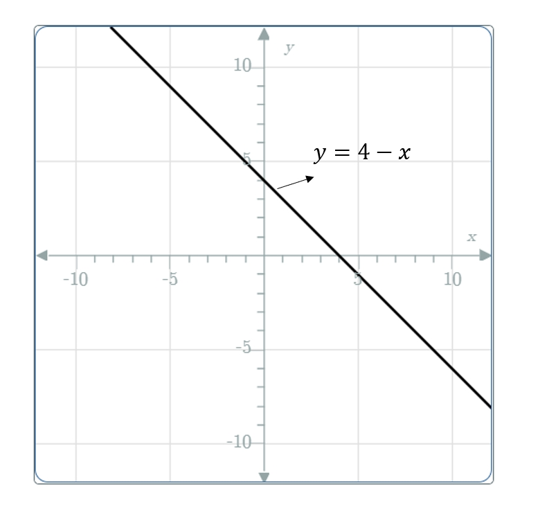
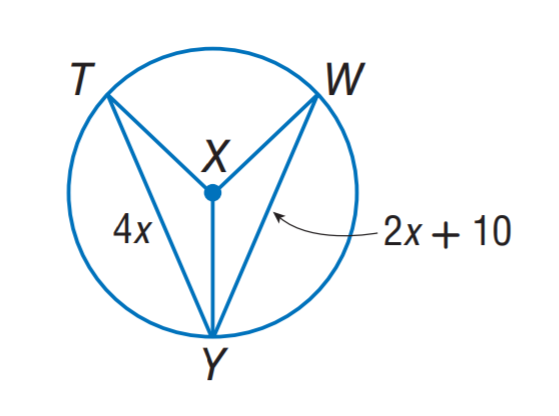

# AVP1348 — Single visual target

MathVerse:626 / MathVista:283 · different type · Numeric representation and conversion

## Shared or similar visual information

The numerical notation 4.

## Evidence locations

- Left image: The notation 4 appears in the formula y = 4 − x.
- Right image: The notation 4 appears in 4x by chord TY.

## Mathematical meanings

Left image: 4 is the constant term of the linear expression. Right image: 4 multiplies x to give chord length TY.

## Same mathematical meanings

no

## Rationales

The notation on the left represents a constant term. The notation on the right represents a variable coefficient.

Only the selected target is annotated. AI visual-review draft; not independently double-annotated by humans.
