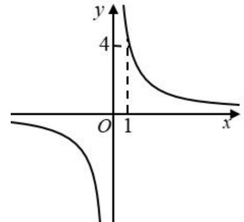
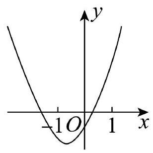

# AVP1349 — Single visual target

MV-MATH:952_1 / MV-MATH:615_1 · same type · Numeric representation and conversion

## Shared or similar visual information

The numerical notation 1.

## Evidence locations

- Left image: The notation 1 appears below the vertical projection of a point on the right branch.
- Right image: The notation 1 appears below the positive x-axis tick.

## Mathematical meanings

Left image: 1 is the horizontal coordinate of the point indicated by the guide. Right image: 1 is the horizontal coordinate of the indicated tick.

## Same mathematical meanings

yes

## Rationales

The numeral gives the same horizontal coordinate in both images.

Only the selected target is annotated. AI visual-review draft; not independently double-annotated by humans.
