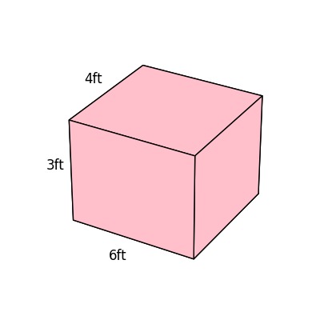
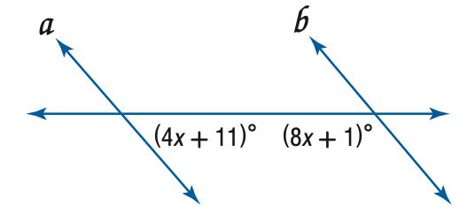

# AVP1350 — Single visual target

DynaMath:74 / MathVista:855 · different type · Numeric representation and conversion

## Shared or similar visual information

The numerical notations 4 ft (left) and 4 (right).

## Evidence locations

- Left image: The notation 4 ft appears beside the upper-left slanted edge of the prism.
- Right image: The notation 4 appears in the angle expression (4x + 11)°.

## Mathematical meanings

Left image: 4 ft gives the prism depth. Right image: 4 multiplies x in the algebraic expression for the marked angle.

## Same mathematical meanings

no

## Rationales

The notation on the left represents a segment length. The notation on the right represents a variable coefficient.

Only the selected target is annotated. AI visual-review draft; not independently double-annotated by humans.
