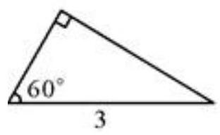
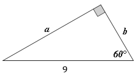

# AVP1351 — Single visual target

MV-MATH:484_1 / MathVerse:377 · same type · Numeric representation and conversion

## Shared or similar visual information

The numerical notation 60°.

## Evidence locations

- Left image: The notation 60° appears at the left vertex beside the angle arc.
- Right image: The notation 60° appears beside the lower-right acute angle.

## Mathematical meanings

Left image: 60° measures the acute angle at that vertex. Right image: 60° measures the marked angle at the right base vertex.

## Same mathematical meanings

yes

## Rationales

Each notation is placed next to the marked angle and specifies the same angle measure of 60°.

Only the selected target is annotated. AI visual-review draft; not independently double-annotated by humans.
