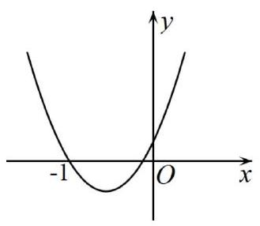
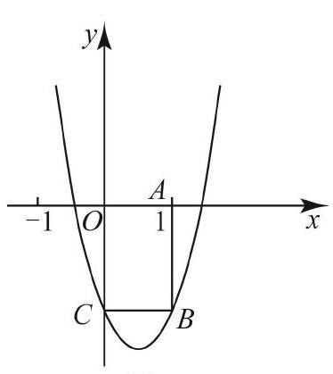

# AVP1352 — Single visual target

MV-MATH:85_1 / MV-MATH:91_1 · same type · Numeric representation and conversion

## Shared or similar visual information

The numerical notation −1.

## Evidence locations

- Left image: The notation −1 appears at the left intercept.
- Right image: The notation −1 appears beside the tick to the left of the origin.

## Mathematical meanings

Left image: −1 is the horizontal coordinate of the left zero. Right image: −1 is the indicated horizontal coordinate to the left of the origin.

## Same mathematical meanings

yes

## Rationales

The numeral gives the same horizontal coordinate in both images.

Only the selected target is annotated. AI visual-review draft; not independently double-annotated by humans.
