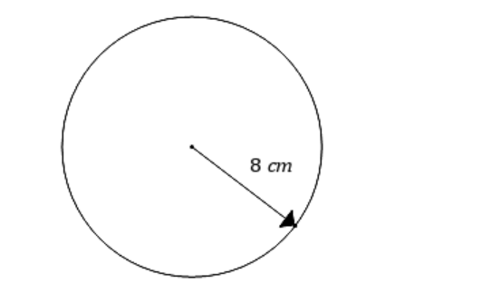
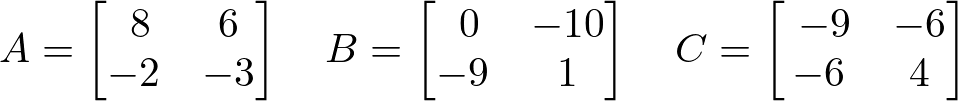

# AVP1356 — Single visual target

MathVerse:387 / DynaMath:487 · different type · Numeric representation and conversion

## Shared or similar visual information

The numerical notations 8 cm (left) and 8 (right).

## Evidence locations

- Left image: The notation 8 cm appears near the radial arrow.
- Right image: The notation 8 appears top-left cell of matrix A.

## Mathematical meanings

Left image: 8 cm is the circle radius. Right image: 8 is the top-left entry of A.

## Same mathematical meanings

no

## Rationales

The notation on the left represents a radius length in centimeters. The notation on the right represents a matrix entry.

Only the selected target is annotated. AI visual-review draft; not independently double-annotated by humans.
